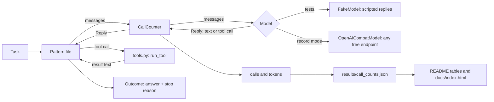

# agentbook

[](https://github.com/shreyas-tech7/agentbook/actions/workflows/ci.yml)

**Status:** v0.1.0-rc1. Twelve patterns, twelve lessons and 36 exercises are done, and every test passes offline. The live record-mode demo has not run yet (see [Limits](#limits)).

## The problem

Most agent tutorials start with a framework. The framework hides the loop, the prompts and the stop rules. When something breaks, you cannot see why. Anthropic's post ["Building effective agents"](https://www.anthropic.com/research/building-effective-agents) gives the opposite advice: start with direct model calls, because most patterns need only a few lines.

agentbook is a small book made of working code. It shows twelve agent patterns. Each pattern is one short Python file, at most 200 lines. Each one has tests, a failure case with the guard that stops it, a plain English lesson and three exercises. A scripted fake model drives every test, so the whole book runs offline in about a second. No framework hides how any of it works.

## How it fits together



A pattern sends messages through the call counter to a model. In tests the model is a `FakeModel` that replays a script. In record mode it is an adapter for any OpenAI-compatible endpoint. A reply is either text or one tool call. The pattern runs tools through a small helper and returns an `Outcome` that always says why it stopped.

## Pattern map

Each row links to its lesson. The call counts come from the counter, not from a person.

<!-- map:start -->
| # | Pattern | Use it when | Avoid it when | Typical calls | Calls in failure case |
| --- | --- | --- | --- | --- | --- |
| 1 | [Tool loop](docs/lessons/01-tool-loop.md) | The steps depend on what the tools return | You already know the steps | 2 | 5 |
| 2 | [Plan and execute](docs/lessons/02-plan-execute.md) | You want to see and check a plan before you pay for it | Each step depends on the last result | 4 | 3 |
| 3 | [Router](docs/lessons/03-router.md) | Requests fall into a few clear groups | Every request needs the same handling | 2 | 1 |
| 4 | [Prompt chain with gates](docs/lessons/04-prompt-chain.md) | The steps are fixed and each output can be checked in code | The steps depend on what the model finds | 2 | 1 |
| 5 | [Fan-out and fan-in](docs/lessons/05-fan-out.md) | Independent parts are known before the run | Parts depend on each other | 4 | 3 |
| 6 | [Orchestrator and workers](docs/lessons/06-orchestrator.md) | The parts depend on the task and cannot be listed in advance | You can list the parts yourself | 4 | 1 |
| 7 | [Evaluator and optimizer](docs/lessons/07-evaluator-optimizer.md) | Quality matters and a critic can name real problems | Code can check the result exactly | 4 | 6 |
| 8 | [Memory](docs/lessons/08-memory.md) | A chat runs for many turns | Each request stands alone | 5 | 3 |
| 9 | [Human approval](docs/lessons/09-human-approval.md) | A tool deletes, sends or pays | Every tool is read-only | 3 | 2 |
| 10 | [Handoff](docs/lessons/10-handoff.md) | The right agent becomes clear mid-conversation | One decision at the start is enough | 2 | 4 |
| 11 | [Budgets and stop rules](docs/lessons/11-budgets.md) | Always, in any loop where the model decides when to stop | Never skip it in a loop | 2 | 5 |
| 12 | [Retrieval as a tool](docs/lessons/12-retrieval.md) | Answers depend on documents the model has not seen | The same documents fit in the prompt every time | 2 | 2 |
<!-- map:end -->

## Results

Every example and every failure case runs once with the scripted `FakeModel`. These are fixed counts from deterministic scripts, so they have no sampling error. A 95% interval would be the number itself, so the table gives none. The runs show what each pattern costs and where it stops. They say nothing about how well any real model does.

<!-- results:start -->
Source: FakeModel scripted runs (no real model), recorded on 2026-11-20. Seed: none (deterministic). Tokens: characters / 4, rounded up.

| Pattern | Example stop | Calls | Est. tokens | Failure stop | Calls | Est. tokens |
| --- | --- | --- | --- | --- | --- | --- |
| Tool loop | `done` | 2 | 185 | `max_steps` | 5 | 535 |
| Plan and execute | `done` | 4 | 193 | `check_failed` | 3 | 131 |
| Router | `done` | 2 | 68 | `fallback` | 1 | 47 |
| Prompt chain with gates | `done` | 2 | 108 | `gate_failed` | 1 | 125 |
| Fan-out and fan-in | `done` | 4 | 157 | `partial` | 3 | 130 |
| Orchestrator and workers | `done` | 4 | 212 | `too_many_workers` | 1 | 206 |
| Evaluator and optimizer | `accepted` | 4 | 201 | `max_rounds` | 6 | 280 |
| Memory | `done` | 5 | 156 | `cut` | 3 | 278 |
| Human approval | `done` | 3 | 352 | `denied` | 2 | 223 |
| Handoff | `done` | 2 | 208 | `max_handoffs` | 4 | 424 |
| Budgets and stop rules | `done` | 2 | 275 | `max_tokens` | 5 | 1655 |
| Retrieval as a tool | `done` | 2 | 207 | `bad_citation` | 2 | 199 |

All twelve examples together: 36 calls and about 2322 estimated tokens.
<!-- results:end -->

### Live examples

<!-- live:start -->
Record mode did not run. No free provider could be reached from the build machine on 2026-11-20 (see BLOCKERS.md, B2). Every number above comes from the scripted FakeModel. `scripts/record_demo.py` runs the live demo once a key exists.
<!-- live:end -->

## Cost per task

The counter estimates tokens as characters divided by four. Read the "Est. tokens" column above as the cost of one task. On a free tier the price is $0. On a paid provider, multiply the tokens by the provider's price per token.

Two rules of thumb fall out of the table:

- Fixed patterns are cheap and predictable. The prompt chain and the router cost one or two calls.
- Loops cost more with every pass, because each call resends the history. In the budget failure case, the fifth call alone costs more than the first two together. That is why lesson 11 sets a token budget, not only a step budget.

## Run it in 10 minutes

You need Python 3.11 or newer. Nothing else.

```bash
git clone https://github.com/shreyas-tech7/agentbook.git
cd agentbook
./init.sh                      # makes .venv, installs, runs every test and check
.venv/bin/python -m agentbook  # lists the twelve patterns
.venv/bin/python -m agentbook tool_loop   # runs an example and its failure case
```

Then read the book in order:

1. Open [lesson 1](docs/lessons/01-tool-loop.md). It quotes the exact code it explains.
2. Run the pattern with `python -m agentbook <name>`.
3. Try the three [exercises](exercises/README.md).
4. Check your answers against the [solutions](solutions/README.md).

To try record mode, copy `.env.example` to your shell, set the three variables and run `python scripts/record_demo.py`. Then run `python scripts/gen_readme.py` to put the live numbers in this README.

## Limits

- Record mode has not run. The build machine could not reach a free provider. All numbers come from the FakeModel.
- Token counts are estimates (four characters per token), not a provider's bill.
- The search in lesson 12 is a keyword match over three documents. It teaches the shape of the pattern, not good search.
- The patterns are for learning. They have no retries for network errors beyond rate limits, no streaming and no logging.
- The book does not claim that one pattern beats another. Each lesson says when to use it and when not to.

## Glossary

- **Model call:** one request to the model and one reply.
- **Tool:** a Python function the model may ask our code to run.
- **Tool call:** a reply that names a tool and its arguments instead of giving text.
- **FakeModel:** a stand-in model that replays a script, so tests need no network.
- **Guard:** plain code that stops a known failure, such as a step limit.
- **Stop reason:** the word in `Outcome.stop` that says why a run ended.
- **Token:** a piece of text a model reads or writes. Here, about four characters.
- **Record mode:** running the patterns against a real model and saving the results.

## Related work

- Anthropic, ["Building effective agents"](https://www.anthropic.com/research/building-effective-agents), December 2024. It names five workflow patterns and the agent loop. agentbook follows its names where they match and writes every lesson in its own words.
- Anthropic's cookbook has notebooks for the five workflow patterns. They call the real API. This build saw them only as search snippets, so it makes no claim about their tests.
- [pguso/agents-from-scratch](https://github.com/pguso/agents-from-scratch) teaches one agent step by step with a local model and no framework. It has an eval folder with golden datasets. It needs a downloaded model to run.
- agenticloops-ai/agentic-ai-engineering also teaches agents from first principles. This build only saw it as a search snippet, so it makes no claim about its contents.

What agentbook adds: one file per pattern under 200 lines, a failure test for every pattern, a scripted model so every test runs offline, a call count for every example, and tests that keep the lessons in step with the code.

## How this was built

AI agents wrote most of this code under Shreyas's direction. The full brief is in [docs/build/BUILD_PROMPT.md](docs/build/BUILD_PROMPT.md). The choices and their reasons are in [DECISIONS.md](DECISIONS.md), and the problems are in [BLOCKERS.md](BLOCKERS.md).

Human checks, not done yet:

- Shreyas has not read the diff yet.
- Shreyas has not run the record-mode demo yet.
- Shreyas has not checked the lessons as a first-time reader yet.

More: [walkthrough](docs/WALKTHROUGH.md), [interview questions](docs/INTERVIEW_QA.md), [demo transcript](docs/DEMO.md), [results page](docs/index.html), [contributing](CONTRIBUTING.md), [changelog](CHANGELOG.md).
